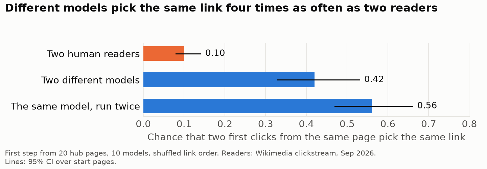
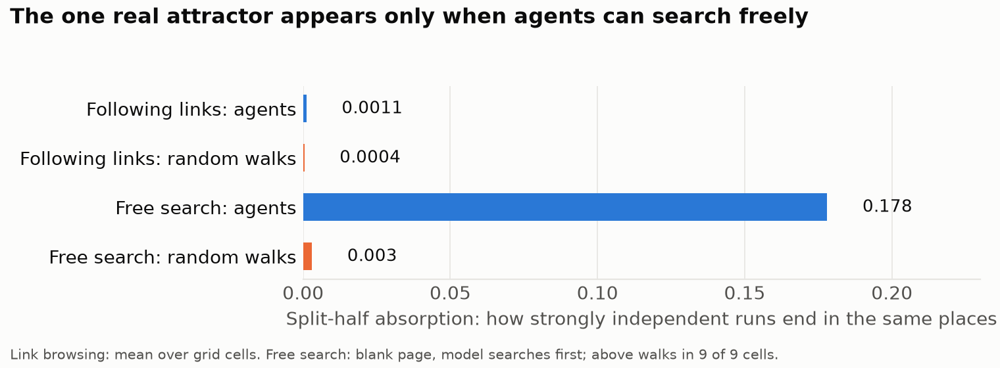
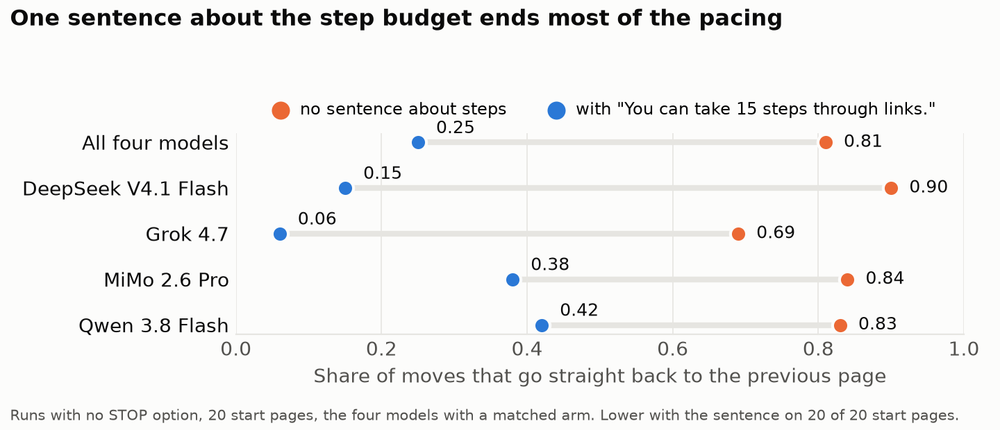
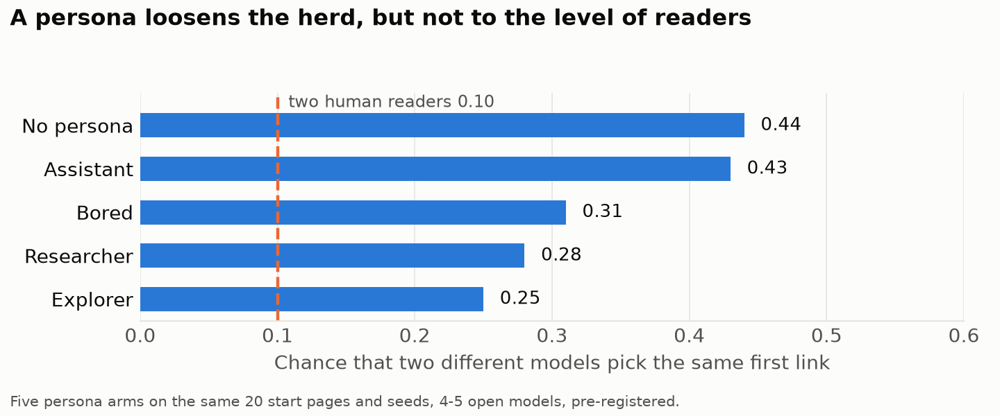

# The Gap Attractor

**What do language-model agents do on Wikipedia when nobody asks them for anything?**

We put a model on a Wikipedia page with one instruction, *"You are free to do what you want."*, and let it follow
links for 15 steps. Then we did it again: more than 6,500 runs, ten models, and many small changes of prompt,
memory and interface. We compared where the models went with random walks on the same link graph and with where
human readers click from the same pages.

The project asks whether models have **attractors**: pages or topics they keep returning to when the task
pressure is removed, and whether such pulls survive a change of framing. If they do, that says something about
what a model tends toward by itself. If they do not, claims about model "preferences" and "curiosity" need more
care than they usually get.

This repository is the public deliverable of a Sentient Futures Project Incubator project (September to November
2026). It holds the experiment harness, the analysis pipeline, a sample of real runs, and a summary of the
results. A paper is in preparation; treat the results here as preliminary.

## What we found

Short version: we went looking for places the models are drawn to, and mostly found something else. Left alone,
different models behave like **one reader, not many**. The detail, with every test and its limits, is in
[docs/results.md](docs/results.md).

**1. Different models make the same choice.** Shown the same page, two different models pick the same first link
about four times as often as two human readers do (0.42 against 0.10). Ten models choose about as variedly as
3.6 independent readers would. Link order was shuffled, so position does not explain it.



**2. There is no attractor in link browsing, and one real attractor in free search.** When agents can only follow
links, they share the first click and then spread out like random walks do. When they start from a blank page
with a search box, independent runs keep ending in the same places, far more than random walks: 36 of 80 openings
landed on pages from Wikipedia's "Unusual articles" list.



**3. The two-page loops are made by the interface.** Without a way to stop, models pace between two pages on 81%
of moves. One added sentence, *"You can take 15 steps through links."*, cuts that to 25%. The loops are not a
preference of the model.



**4. Stopping is not a stable trait either.** Models that stop mostly say that no task was given. How often they
stop depends on the wording, on whether the action is a tool call, on memory, and on the persona, which moves one
model's stop rate by up to 0.55.

**5. A persona loosens the herd a little.** Asking a model to be an explorer or a researcher lowers the agreement
between models, but it stays well above the level of human readers. The "helpful assistant" persona changes
nothing.



**6. A planted past changes their words, not their route.** Shown a browsing history that was not theirs, models
take up its phrasing, but they do not follow its path.

**7. Two agents sharing one working memory do not copy each other.** In 120 two-agent worlds, sharing a jointly
edited context lowered revisits and raised the number of pages a pair covered. The agents did not stay together
longer. The sameness of the population comes from the models, not from contact between agents.

**What did not survive.** We kept a register of 83 claims made along the way and tested each one. About half held
as stated. Settling over a run, an effect of model size, a pull toward less familiar pages, and several of our own
early headlines did not. The list is in [docs/results.md](docs/results.md#what-did-not-survive).

Why this matters for safety and welfare research: using several models to check each other assumes they err
independently, and these models do not choose independently. And a claim that a model "prefers" or "seeks"
something needs the controls used here (a human baseline on the same choices, random walks, interface
ablations), because each of them reversed one of our own first readings.

## How the experiment works

- **Environment.** English Wikipedia, dump of 1 September 2026, read offline. Pages are states and links are
  actions.
- **One step.** The model sees the full article text and a list of the page's links as plain titles, and answers
  with a short reason and one title. The harness opens that page. There are no tools unless a condition adds them.
- **One run.** One start page and up to 15 steps in a fresh context. Runs never see each other.
- **Start pages.** 20 well-connected "hub" articles for the main grid, drawn from a pool built for the project
  ([data/start_pages/](data/start_pages/)).
- **Variants.** A: start on a given page and follow links. B: start from a blank page with a search. C: links
  plus search at every step. D: search first, then links or search. See [docs/variants.md](docs/variants.md).
- **What is varied.** Prompt wording, whether a STOP option exists, whether the step limit is disclosed, what the
  model remembers of earlier steps (seven memory settings), reasoning effort, persona, text replies or tool calls.
  One variable changes per batch.
- **Controls.** Link order is reshuffled at every step with a logged seed. Nothing the model sees names the
  experiment. Steps where the harness had to pick a link are excluded from choice statistics.
- **Baselines.** Random walks on the same graph (uniform, with jumps, without revisits) and human readers from
  the Wikimedia clickstream. No fitted choice models.
- **Logging.** Every step records the full choice set, the raw model output, the parsed choice, the stated
  reason, token counts and the exact request. The prompt is stored verbatim with every run.

The original design sketch, with hypotheses H1 to H10, is in [docs/design.md](docs/design.md). The definitions
and the statistics are in [docs/methods.md](docs/methods.md).

## Try it

You need [uv](https://docs.astral.sh/uv/) and Python 3.10 or newer. Clone with git, because the harness records
its own commit in every run.

**1. Run the harness offline (no key, no download, about a minute).** A mock model walks a small synthetic wiki:

```bash
uv sync --extra dev
uv run gap-attractor provider=mock wikipedia=fixture experiment=smoke
uv run pytest
```

The run is written to `outputs/`. Open its `transcript.md` to see what a run looks like.

**2. Read and analyse real runs (no key, no download).** [data/sample_runs/](data/sample_runs/) holds 14 real runs
from the start page "Albert Schweitzer": five models with and without a STOP option, and four with the
step-budget sentence. All five models make the same first click.

```bash
uv sync --extra dev --extra analysis
uv run gap-attractor-analyze 'data.paths=[data/sample_runs]' 'stages=[outcomes]'
```

**3. Run a real model on the synthetic wiki (API key, a few cents).** Copy `.env.example` to `.env`, add an
[OpenRouter](https://openrouter.ai/) key, then:

```bash
uv run --env-file .env gap-attractor provider=openrouter provider.model=deepseek/deepseek-v4.1-flash \
  wikipedia=fixture experiment.step_limit=5
```

**4. Reproduce the real setting.** This needs the English Wikipedia dump (about 27 GB) and one-time index builds.
[docs/reproduce.md](docs/reproduce.md) has the steps and the commands behind the main experiments.

## What is in this repository

| Path | Content |
|---|---|
| `src/gap_attractor/harness/` | The run loop, memory plug-ins, logging |
| `src/gap_attractor/wikipedia/`, `search/` | Offline dump reader, link extraction, title search |
| `src/gap_attractor/providers/` | Model providers: mock, OpenRouter, OpenAI, Groq |
| `src/gap_attractor/analysis/` | `gap-attractor-analyze`: outcomes, clicks, walks, hypotheses, convergence, loops |
| `configs/` | Hydra configs: variants, prompts, providers, experiments, analysis |
| `scripts/` | Resource builders (topics, clickstream, link graph) and log checks |
| `experiments/context_file/` | Agents whose memory is a context file they edit, alone or shared by two agents |
| `experiments/siamese/` | Side study: several agents share one capped context while solving coding tasks |
| `data/start_pages/` | The start-page pools |
| `data/sample_runs/` | 14 real runs with full step logs |
| `tests/` | Test suite; runs offline on a synthetic wiki |
| `docs/` | Results, methods, design, configuration, reproduction guide. Start at [docs/README.md](docs/README.md) |

## Status and limits

- Results are preliminary and the paper is not written yet. Numbers may change with further checks.
- One environment (Wikipedia), 20 hub start pages for the main grid, 15-step runs, sampling temperature 1.
- The November experiments (personas, model size, shared context) ran without Google, Anthropic and OpenAI models,
  because provider access was blocked at the time.
- The qualitative coding of model reasoning is reported as descriptive shares only.
- The full run logs (about 24 GB) are not in this repository. A dataset release is planned with the paper.

## Team

Cindy Bosibori, Claire Xu, Gagana M D, Kacper Dudzic, Pooja Manvikar, Sachin Bagoriya, Sebastian Abundis,
Sergei Kudriashov and Yuliya Komarova (names in alphabetical order). Mentor: Julia Bossmann.

The project was carried out in the Sentient Futures Project Incubator, autumn 2026.

## Licence and credits

Code: MIT, see [LICENSE](LICENSE). Data, Wikipedia text and third-party material: see [NOTICE.md](NOTICE.md).
To cite the project, use [CITATION.cff](CITATION.cff).
