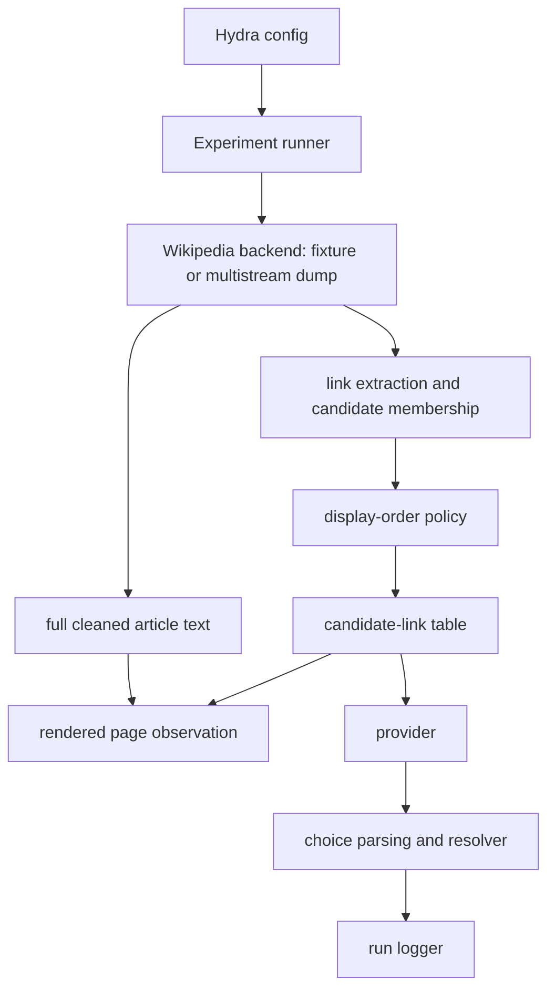

# Harness architecture

`eligible_candidates_source_order` is extracted from the page before the display policy runs.
`displayed_candidates` is a permutation of that same list. The source policy is identity; the
seeded-shuffle policy uses a deterministic per-run/per-step seed. Neither policy filters, samples,
adds, or removes a candidate.

Each observation contains the full cleaned article content available from the backend and a separate
candidate-link table. Wiki markup, raw URLs, and link destinations are removed from the article
prose while visible anchor text remains. The display-order intervention applies only to the table.
`experiment.article_max_chars: null` is the default; any explicit safety limit is logged with
`article_content_was_truncated`.

The fixture and dump implement the same page retrieval, membership, category, and resolver-facing
operations. Fixture data is expressly limited to offline engineering validation. Dump mode uses the
existing multistream XML and index layout and has no network dependency; current-revision dumps do
not provide first-revision creation timestamps, so that provenance is recorded rather than silently
filled by an HTTP request.

Collection writes dataset, run, and step layers plus the raw model output, rendered request, retry
attempts, provider/model provenance, source/display order, category metadata, and resolution data.
`semantic_cluster_label` remains Wikipedia category metadata—not a validated semantic clustering
algorithm. Downstream analysis consumes these logs and is the only place to compute attractor,
entropy, novelty, centrality, or other scientific measures.
